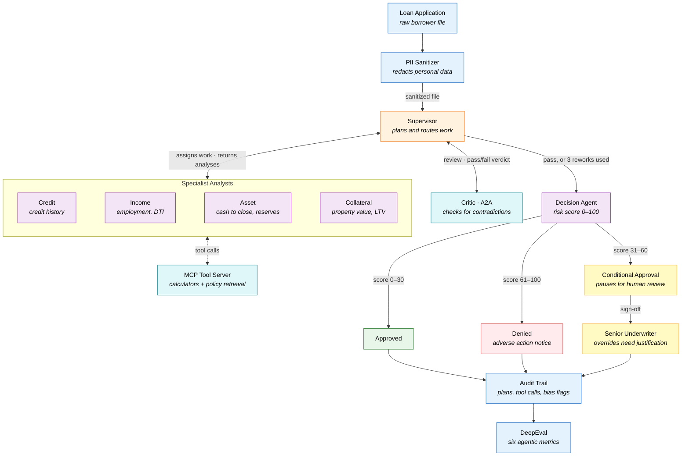

# Mortgage Underwriting Multi-Agent System — with DeepEval

## Why This Project Exists

Conventional mortgage underwriting struggles in three areas.

- **It is slow.** A single application typically takes three to five days, because insights from the credit, employment, asset and property reviews have to be pieced together by hand. When one review turns out to be incomplete or contradicts another, there is no built-in way to send just that piece back for another look.
- **It is inconsistent.** Two underwriters looking at the same file can arrive at different answers because so much depends on personal judgment. No structured quality check sits between the analysis and the final call to flag missing information or conflicting conclusions.
- **Compliance is hard to scale.** Protecting personal data, watching for bias, keeping a complete audit trail and routing cases for human approval are all manual chores that invite mistakes. With nothing enforcing these rules automatically at each stage, compliance rests on the diligence of whoever is handling the file.

## Our Approach

The system splits underwriting across a team of cooperating agents arranged in three layers.

**Specialist analysts.** Each of four agents is responsible for a single slice of the loan file:

| Agent | Responsibility |
|---|---|
| Credit Analyst | Examines the borrower's credit history |
| Income Analyst | Confirms employment and computes the debt-to-income (DTI) ratio |
| Asset Analyst | Checks that the borrower has enough cash to close and adequate reserves |
| Collateral Analyst | Evaluates the property's value and the loan-to-value (LTV) ratio |

**Coordination.** Three further agents orchestrate and judge the specialists' work:

- **Supervisor Agent** — draws up the analysis plan, dispatches tasks and runs a rework loop with a fixed cap on iterations.
- **Critic Agent** — published as an A2A service, it cross-checks every analysis for contradictions.
- **Decision Agent** — combines the findings into a risk score between 0 and 100 and a final outcome: approved, conditionally approved, or denied.

## How It Works End to End

1. The loan file is scrubbed of sensitive data before the workflow receives it.
2. The four specialists study the file in parallel. Each one consults only the policy section it owns and relies on deterministic calculators exposed through MCP for any math.
3. An LLM-driven Supervisor sequences the work and can send analyses back for revision, up to a set limit.
4. The Critic — the only agent reachable as an A2A service — performs a peer review of the specialists' output.
5. The Decision Agent produces a verdict backed by a risk score. A senior underwriter is pulled in only when the result is a conditional approval.
6. Each run is evaluated against six agentic metrics from DeepEval.

## Architecture Diagram

Solid arrows show how the loan file moves through the system, and the dotted arrow shows tool calls. When the Critic fails an analysis, the Supervisor sends it back to the relevant specialist, for up to three rounds. Only conditional approvals go to a person.

## Architecture Details

### Specialist Analysts
Every analyst owns one numbered block of underwriting policy: credit (1.x), income (2.x), assets (3.x) and collateral (4.x). All of them receive the complete set of MCP tools and decide for themselves which to invoke, using `bind_tools`.

### Coordination Layer
The Supervisor is an LLM that outputs an ordered plan, directs work between agents and stops revisions once `MAX_REVISIONS = 3` is reached. The Critic responds over A2A with a simple pass or fail. The Decision Agent turns that verdict, together with the analyses, into the final determination.

### Compliance and Security
- Personal identifiers are masked *before* the graph runs, so unredacted PII never lands in graph state or in the checkpointer.
- Each agent's output is scanned for language referring to protected characteristics.
- Policy lookups return the specific section numbers they draw on, giving every conclusion a traceable citation.

### Human in the Loop
A case stops for human review only when the outcome is `CONDITIONAL_APPROVAL`, using LangGraph's `interrupt()`. The senior underwriter picks the case back up with `Command(resume=...)`, and any decision that overrides the system's recommendation must include a written justification.
