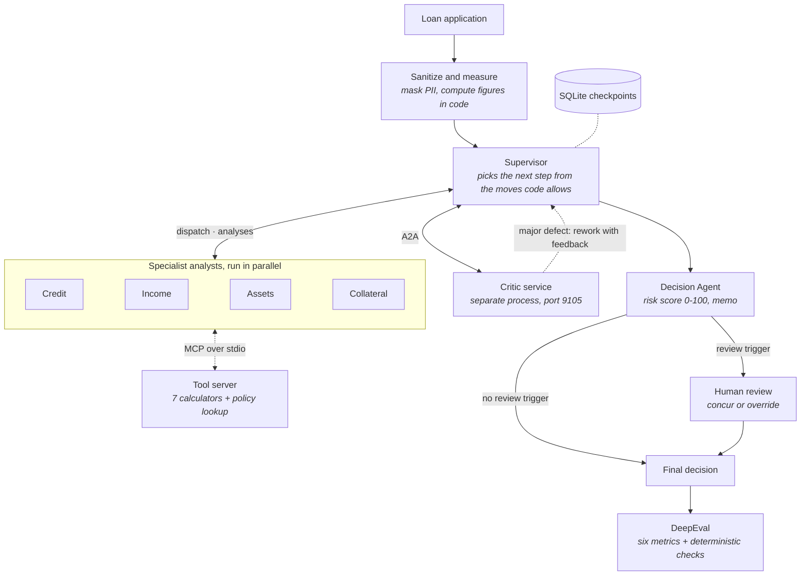

# Mortgage Underwriting Multi-Agent System, with DeepEval

<!-- demo.gif goes here once recorded:  -->

## What it does

A team of AI agents underwrites a mortgage application. Four specialist analysts (credit, income, assets, collateral) work in parallel, a Supervisor decides each next step, a Critic reviews the quality of the analyses, and a Decision Agent scores the file and writes a decision memo. Borderline files stop for a human underwriter, who can concur or override with a written justification.

You run it on your own machine: a Streamlit page shows every step as it happens, and a DeepEval run scores the agents on six agentic metrics. The applications and the policy are synthetic and were written for this repository.

### Why this problem

Conventional mortgage underwriting struggles in three areas.

- **It is slow.** A single application typically takes three to five days, because insights from the credit, employment, asset and property reviews have to be pieced together by hand.
- **It is inconsistent.** Two underwriters looking at the same file can arrive at different answers, and no structured quality check sits between the analysis and the final call.
- **Compliance is hard to scale.** Protecting personal data, watching for bias, keeping an audit trail and routing cases for human approval are manual chores.

## Architecture



| Component | File | What it is |
|---|---|---|
| Calculations | `src/underwriter/metrics.py` | Every figure and threshold, as pure functions. The agents, the UI and the evaluation all read the same numbers. |
| Tool server | `mcp_server.py`, `mcp_client.py` | An MCP server (stdio subprocess) exposing seven calculators and two policy lookups. Each specialist opens its own session. |
| Claude helpers | `llm.py` | One client per run, a structured-output call and a tool loop, on the official `anthropic` SDK. |
| Specialists | `agents/specialists.py` | One runner and four prompts. Each analyst calls the tools, cites policy sections and returns a structured analysis. |
| Critic | `agents/critic.py`, `critic_service.py`, `a2a_client.py` | Reviews analysis quality. It runs as its own A2A service process. |
| Supervisor | `agents/supervisor.py` | Code lists the allowed moves; the model picks one; the pick is what runs. |
| Decision | `agents/decision.py` | Risk score, decision memo, the human-review rules and override validation. |
| Workflow | `graph.py` | The LangGraph graph and its two entry points, `run_case()` and `resume_case()`. |
| UI | `app.py` | One Streamlit page. |
| Evaluation | `eval/run_eval.py` | Runs the cases and scores them with DeepEval. |

## How a case flows

1. The application is masked (name, SSN, phone, email, address) before it enters the graph, and `metrics.py` computes the figures.
2. The Supervisor picks a step. At the start that is usually all four specialists, which then run at the same time.
3. Each specialist calls the calculators with the inputs given to it, looks up the policy sections it relies on, and returns an analysis.
4. The Critic reviews the analyses. If it finds a major defect, the Supervisor sends that analyst back with the defect text and its previous analysis. This can happen up to three times.
5. The Decision Agent gives a risk score: 0 to 30 approve, 31 to 60 conditional approval, 61 to 100 deny.
6. A human reviews the file if the decision is a conditional approval, the score is within 5 points of a band edge, the Critic is still failing, or an analysis is missing.

## Design choices

- **Separate processes, separate clients.** The tool server is a stdio subprocess and the Critic is its own service. Each run opens its own Claude client and closes it when it ends. Every network call has a timeout, and a caller always waits longer than the service it called.
- **The Supervisor's choice is the route.** It picks the next step on every pass from the moves code allows. Each pick is logged with its reason and the alternatives, and that log is the plan DeepEval grades.
- **Rework carries feedback.** A reworked specialist receives the Critic's defect and its own previous analysis.
- **The Critic reviews, it does not underwrite.** It reports defects in the analyses separately from weaknesses of the borrower. The verdict is computed in code: fail if and only if there is a major defect.
- **Failures are explicit.** An analysis is `complete` or `failed`. After two failed attempts the area is not retried and the case goes to human review.
- **Figures cannot go negative or drift.** Reserves are zero with a stated shortfall when closing can't be funded. Case records hold raw facts only, and a test checks that every threshold in the code appears in the policy text.
- **Human review has four triggers**, so a one-point change in score does not remove the review.
- **Specialists run in parallel** using LangGraph `Send`, and write only merge-safe state keys.
- **Paused cases survive a restart**, through a SQLite checkpointer.
- **Evaluation compares real arguments.** Expected tool arguments come from the same functions the agents use, argument values are compared, and the judge model is configured separately. Each case accepts a set of outcomes, because model output is probabilistic.

## Run it

Requires Python 3.12 and [`uv`](https://docs.astral.sh/uv/).

```bash
uv sync
cp .env.example .env        # then add your Anthropic API key to .env
uv run streamlit run app.py
```

A Claude subscription is not an API key; create a key in the Anthropic Console. A run calls Claude and costs money (see the results table). The app starts the Critic service for you.

## Tests and evaluation

```bash
uv run pytest                                   # no API key, no network
uv run python eval/run_eval.py                  # all four cases; calls Claude
uv run python eval/run_eval.py --case CASE-001  # one case
```

The tests use a deterministic stand-in for Claude, the real MCP server and a real SQLite checkpoint. The evaluation writes `eval/results.json`, which the app shows in its Evaluation tab.

The six DeepEval metrics are Task Completion, Step Efficiency, Tool Correctness, Argument Correctness, Plan Quality and Plan Adherence. The four trace-based ones are given the recorded run as nested spans, in the shape DeepEval's own tracer produces.

## Sample results

One evaluation run on 2026-11-12, agents and judge both on `claude-opus-5-5`. Scores are shown as measured; the system is not tuned to raise them, and they vary from run to run.

| Case | Outcome (risk score) | Human review | Run cost | Task Completion | Step Efficiency | Tool Correctness | Argument Correctness | Plan Quality | Plan Adherence |
|---|---|---|---|---|---|---|---|---|---|
| CASE-001 | APPROVED (8) | no | $0.31 | 0.95 | 0.75 | 1.00 | 1.00 | 0.50 | 1.00 |
| CASE-002 | CONDITIONAL_APPROVAL (44) | yes | $0.35 | 0.95 | 0.75 | 1.00 | 1.00 | 0.50 | 0.75 |
| CASE-003 | DENIED (76) | no | $0.35 | 0.95 | 1.00 | 0.90 | 1.00 | 0.50 | 1.00 |
| CASE-004 | DENIED (98) | no | $0.38 | 0.95 | 0.90 | 1.00 | 1.00 | 0.25 | 1.00 |

- **Arguments:** every calculator call received the arguments `metrics.py` expects, in all four cases.
- **Plan Quality** is the low score. The Supervisor decides one step at a time with a short reason, so there is no detailed up-front plan for the judge to grade.
- **Deterministic checks:** 19 of 20 passed. CASE-003 was denied with a risk score of 76, clear of the band edge, so no review trigger applied, while its case record expects a human review.
- **Cost** is for the underwriting run only. Judging added about $0.45 to $0.50 per case.

## Limitations

- The policy and the four applications are synthetic. Nothing here is lending guidance, and no real lender uses this policy.
- Scope is one loan type: a conventional purchase of a single-unit primary residence.
- Model output varies between runs, so scores and borderline outcomes vary too.
- The bias screen is a keyword list. It flags language; it is not a fair-lending audit.
